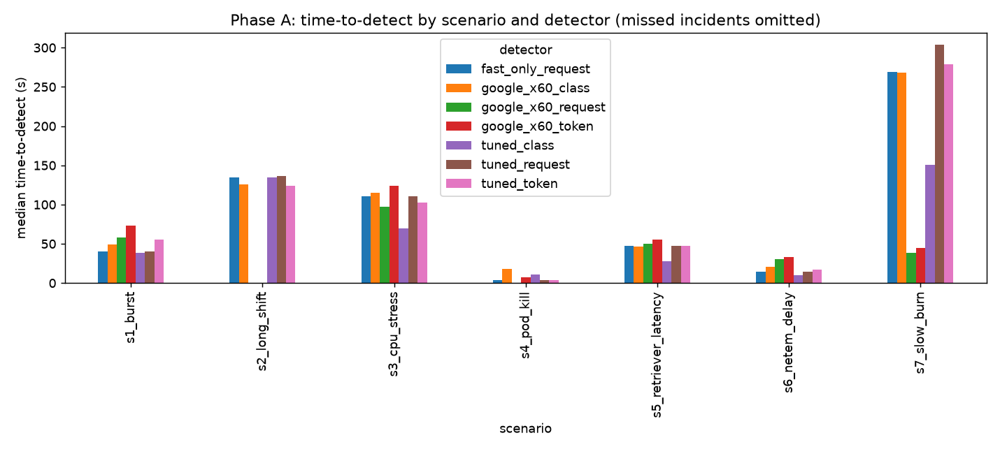
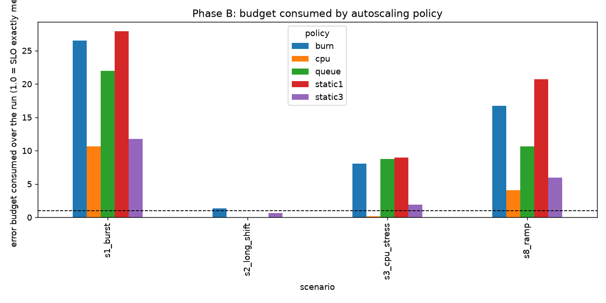

# SLO-Loop Lab results

_Generated 2026-11-19T11:02:41_

SLO target: 0.99; TTFT thresholds (s): {'short': 10.4, 'medium': 15.6, 'long': 16.3}; calibrated=True

## Phase A - detection (H1/H2)

| scenario | detector | runs | detect_rate | ttd_median_s | ttd_ci_lo | ttd_ci_hi | false_pages_per_hr |
|---|---|---|---|---|---|---|---|
| s0_baseline | fast_only_request | 6 | n/a | n/a | n/a | n/a | 0.00 |
| s0_baseline | google_x60_class | 6 | n/a | n/a | n/a | n/a | 0.00 |
| s0_baseline | google_x60_request | 6 | n/a | n/a | n/a | n/a | 0.00 |
| s0_baseline | google_x60_token | 6 | n/a | n/a | n/a | n/a | 0.00 |
| s0_baseline | tuned_class | 6 | n/a | n/a | n/a | n/a | 0.00 |
| s0_baseline | tuned_request | 6 | n/a | n/a | n/a | n/a | 0.00 |
| s0_baseline | tuned_token | 6 | n/a | n/a | n/a | n/a | 0.00 |
| s1_burst | fast_only_request | 6 | 1.00 | 40.50 | 27.00 | 83.00 | 1.43 |
| s1_burst | google_x60_class | 6 | 1.00 | 49.00 | 34.00 | 88.00 | 11.43 |
| s1_burst | google_x60_request | 6 | 0.83 | 58.00 | 45.00 | 113.00 | 1.43 |
| s1_burst | google_x60_token | 6 | 0.83 | 73.00 | 51.00 | 103.00 | 1.43 |
| s1_burst | tuned_class | 6 | 1.00 | 38.50 | 22.50 | 73.50 | 0.00 |
| s1_burst | tuned_request | 6 | 1.00 | 40.50 | 29.00 | 75.50 | 0.00 |
| s1_burst | tuned_token | 6 | 1.00 | 55.50 | 39.50 | 108.50 | 0.00 |
| s2_long_shift | fast_only_request | 6 | 0.50 | 135.00 | 88.00 | 160.00 | 0.00 |
| s2_long_shift | google_x60_class | 6 | 0.33 | 125.50 | 88.00 | 163.00 | 0.00 |
| s2_long_shift | google_x60_request | 6 | 0.00 | n/a | n/a | n/a | 0.00 |
| s2_long_shift | google_x60_token | 6 | 0.00 | n/a | n/a | n/a | 0.00 |
| s2_long_shift | tuned_class | 6 | 0.50 | 135.00 | 83.00 | 156.00 | 0.00 |
| s2_long_shift | tuned_request | 6 | 0.33 | 136.00 | 109.00 | 163.00 | 0.00 |
| s2_long_shift | tuned_token | 6 | 0.33 | 124.00 | 88.00 | 160.00 | 0.00 |
| s3_cpu_stress | fast_only_request | 6 | 0.83 | 111.00 | 60.00 | 132.00 | 0.00 |
| s3_cpu_stress | google_x60_class | 6 | 0.83 | 115.00 | 66.00 | 142.00 | 0.00 |
| s3_cpu_stress | google_x60_request | 6 | 0.33 | 97.00 | 66.00 | 128.00 | 0.00 |
| s3_cpu_stress | google_x60_token | 6 | 0.50 | 124.00 | 65.00 | 127.00 | 0.00 |
| s3_cpu_stress | tuned_class | 6 | 0.83 | 70.00 | 42.00 | 107.00 | 1.43 |
| s3_cpu_stress | tuned_request | 6 | 0.83 | 111.00 | 60.00 | 142.00 | 0.00 |
| s3_cpu_stress | tuned_token | 6 | 0.83 | 103.00 | 57.00 | 142.00 | 0.00 |
| s4_pod_kill | fast_only_request | 6 | 0.50 | 4.00 | 3.00 | 72.00 | 1.25 |
| s4_pod_kill | google_x60_class | 6 | 0.17 | 18.00 | n/a | n/a | 0.00 |
| s4_pod_kill | google_x60_request | 6 | 0.00 | n/a | n/a | n/a | 0.00 |
| s4_pod_kill | google_x60_token | 6 | 0.17 | 7.00 | n/a | n/a | 0.00 |
| s4_pod_kill | tuned_class | 6 | 0.67 | 11.00 | 3.00 | 61.00 | 1.25 |
| s4_pod_kill | tuned_request | 6 | 0.33 | 3.50 | 3.00 | 4.00 | 1.25 |
| s4_pod_kill | tuned_token | 6 | 0.33 | 3.50 | 3.00 | 4.00 | 0.00 |
| s5_retriever_latency | fast_only_request | 12 | 1.00 | 47.00 | 34.50 | 56.00 | 1.43 |
| s5_retriever_latency | google_x60_class | 12 | 1.00 | 46.50 | 34.00 | 54.00 | 0.71 |
| s5_retriever_latency | google_x60_request | 12 | 1.00 | 50.00 | 39.00 | 62.00 | 0.71 |
| s5_retriever_latency | google_x60_token | 12 | 1.00 | 55.00 | 40.00 | 65.50 | 0.71 |
| s5_retriever_latency | tuned_class | 12 | 1.00 | 28.00 | 20.50 | 37.00 | 1.43 |
| s5_retriever_latency | tuned_request | 12 | 1.00 | 47.00 | 30.00 | 56.00 | 1.43 |
| s5_retriever_latency | tuned_token | 12 | 1.00 | 47.00 | 32.00 | 56.00 | 1.43 |
| s6_netem_delay | fast_only_request | 6 | 1.00 | 14.00 | 11.00 | 25.00 | 5.71 |
| s6_netem_delay | google_x60_class | 6 | 1.00 | 21.00 | 15.50 | 26.50 | 4.29 |
| s6_netem_delay | google_x60_request | 6 | 1.00 | 30.50 | 19.50 | 55.00 | 5.71 |
| s6_netem_delay | google_x60_token | 6 | 1.00 | 33.00 | 24.50 | 87.50 | 4.29 |
| s6_netem_delay | tuned_class | 6 | 0.83 | 10.00 | 6.00 | 15.00 | 5.71 |
| s6_netem_delay | tuned_request | 6 | 1.00 | 14.00 | 9.00 | 25.50 | 4.29 |
| s6_netem_delay | tuned_token | 6 | 1.00 | 17.00 | 12.00 | 28.00 | 7.14 |
| s7_slow_burn | fast_only_request | 25 | 0.80 | 269.00 | 234.00 | 286.50 | 1.60 |
| s7_slow_burn | google_x60_class | 25 | 0.40 | 268.00 | 68.00 | 329.00 | 0.80 |
| s7_slow_burn | google_x60_request | 25 | 0.08 | 38.50 | 8.00 | 69.00 | 1.60 |
| s7_slow_burn | google_x60_token | 25 | 0.08 | 45.00 | 21.00 | 69.00 | 0.80 |
| s7_slow_burn | tuned_class | 25 | 0.92 | 151.00 | 134.00 | 182.10 | 2.40 |
| s7_slow_burn | tuned_request | 25 | 0.72 | 303.50 | 274.50 | 321.00 | 2.40 |
| s7_slow_burn | tuned_token | 25 | 0.56 | 278.50 | 237.00 | 296.00 | 0.80 |

Each detector's windows were stretched to match the request rate (median factor, x1 = as defined): fast_only_request x3, google_x60_class x4, google_x60_request x6, google_x60_token x6, tuned_class x1, tuned_request x2, tuned_token x2. Rules whose stretched long window did not fit in the run were not evaluated (`rules_dropped`).

## Phase A - root-cause attribution baseline (H4)

| scenario | truth | incidents | attribution_acc | abstain_rate | always_llm_acc | random_expected | class_adjusted_acc | failure_tagged_acc |
|---|---|---|---|---|---|---|---|---|
| s1_burst | llm | 6 | 1.00 | 0.00 | 1.00 | 0.33 | 1.00 | 1.00 |
| s2_long_shift | llm | 6 | 1.00 | 0.00 | 1.00 | 0.33 | 1.00 | 1.00 |
| s3_cpu_stress | llm | 6 | 1.00 | 0.00 | 1.00 | 0.33 | 1.00 | 1.00 |
| s4_pod_kill | llm | 6 | 0.67 | 0.17 | 1.00 | 0.33 | 0.83 | 0.83 |
| s5_retriever_latency | retriever | 12 | 1.00 | 0.00 | 0.00 | 0.33 | 1.00 | 1.00 |
| s6_netem_delay | llm | 6 | 0.00 | 1.00 | 1.00 | 0.33 | 0.00 | 1.00 |
| s7_slow_burn | retriever | 25 | 0.08 | 0.20 | 0.00 | 0.33 | 0.16 | 0.96 |

`attribution_acc` is the original latency-only estimator (pooled stage medians). `class_adjusted_acc` compares each request with the baseline of its own prompt class; `failure_tagged_acc` additionally uses which hop a failed request names (http_503 = retriever, llm_error/timeout = llm). The last two were designed AFTER the Phase A data had been seen: they are exploratory, and a claim needs fresh repetitions that were not used to design them.

## Phase A - sensitivity to the grace period

| detector | grace_s | detect_rate | false_pages_total | false_pages_per_hr |
|---|---|---|---|---|
| fast_only_request | 60.00 | 0.82 | 10 | 1.47 |
| google_x60_class | 60.00 | 0.63 | 13 | 1.68 |
| google_x60_request | 60.00 | 0.40 | 8 | 1.25 |
| google_x60_token | 60.00 | 0.43 | 6 | 0.86 |
| tuned_class | 60.00 | 0.87 | 11 | 1.75 |
| tuned_request | 60.00 | 0.76 | 9 | 1.51 |
| tuned_token | 60.00 | 0.70 | 8 | 1.10 |
| fast_only_request | 120.00 | 0.82 | 7 | 1.49 |
| google_x60_class | 120.00 | 0.63 | 3 | 0.68 |
| google_x60_request | 120.00 | 0.40 | 4 | 1.10 |
| google_x60_token | 120.00 | 0.43 | 4 | 0.82 |
| tuned_class | 120.00 | 0.87 | 9 | 2.04 |
| tuned_request | 120.00 | 0.76 | 7 | 1.76 |
| tuned_token | 120.00 | 0.70 | 5 | 0.96 |
| fast_only_request | 180.00 | 0.82 | 6 | 1.45 |
| google_x60_class | 180.00 | 0.63 | 2 | 0.58 |
| google_x60_request | 180.00 | 0.40 | 3 | 0.99 |
| google_x60_token | 180.00 | 0.43 | 2 | 0.58 |
| tuned_class | 180.00 | 0.87 | 8 | 2.03 |
| tuned_request | 180.00 | 0.76 | 6 | 1.70 |
| tuned_token | 180.00 | 0.70 | 3 | 0.74 |

A page is TRUE only if it starts inside [incident start, incident end + grace]. If false pages vanish as the grace grows they are late echoes of the incident (long windows still remembering it); if they stay, they are unrelated to it. `summarize --pages` shows each one.

## Phase B - autoscaling (H3)

| scenario | policy | runs | budget_mean | budget_ci_lo | budget_ci_hi | budget_token_mean | p95_ttft_all_s | error_ratio | mean_replicas | time_at_1_replica |
|---|---|---|---|---|---|---|---|---|---|---|
| s1_burst | burn | 3 | 26.52 | 26.00 | 27.22 | 25.82 | 29.09 | 0.06 | 2.05 | 0.46 |
| s1_burst | cpu | 3 | 10.65 | 1.33 | 20.36 | 11.44 | 17.65 | 0.00 | 2.69 | 0.09 |
| s1_burst | queue | 3 | 21.97 | 18.67 | 26.35 | 21.66 | 32.74 | 0.00 | 1.55 | 0.62 |
| s1_burst | static1 | 3 | 27.89 | 17.09 | 35.93 | 25.17 | 35.74 | 0.00 | 1.00 | 1.00 |
| s1_burst | static3 | 3 | 11.77 | 4.43 | 21.56 | 10.87 | 21.17 | 0.00 | 3.00 | 0.00 |
| s2_long_shift | burn | 3 | 1.35 | 0.00 | 4.04 | 1.46 | 9.52 | 0.00 | 1.28 | 0.86 |
| s2_long_shift | cpu | 3 | 0.00 | 0.00 | 0.00 | 0.00 | 6.61 | 0.00 | 2.67 | 0.11 |
| s2_long_shift | queue | 3 | 0.00 | 0.00 | 0.00 | 0.00 | 8.25 | 0.00 | 1.00 | 1.00 |
| s2_long_shift | static1 | 3 | 0.00 | 0.00 | 0.00 | 0.00 | 8.05 | 0.00 | 1.00 | 1.00 |
| s2_long_shift | static3 | 3 | 0.67 | 0.00 | 2.02 | 0.97 | 6.71 | 0.00 | 3.00 | 0.00 |
| s3_cpu_stress | burn | 6 | 8.09 | 4.30 | 11.16 | 10.31 | 18.07 | 0.00 | 1.73 | 0.61 |
| s3_cpu_stress | cpu | 6 | 0.16 | 0.00 | 0.47 | 0.50 | 6.43 | 0.00 | 2.53 | 0.11 |
| s3_cpu_stress | queue | 6 | 8.73 | 5.19 | 12.96 | 11.01 | 17.18 | 0.00 | 1.11 | 0.89 |
| s3_cpu_stress | static1 | 6 | 8.98 | 4.92 | 13.04 | 10.73 | 16.93 | 0.00 | 1.00 | 1.00 |
| s3_cpu_stress | static3 | 6 | 1.92 | 0.59 | 3.33 | 2.30 | 8.36 | 0.00 | 3.00 | 0.00 |
| s8_ramp | burn | 6 | 16.74 | 7.93 | 26.39 | 18.39 | 25.49 | 0.01 | 1.62 | 0.68 |
| s8_ramp | cpu | 6 | 4.09 | 1.75 | 6.43 | 4.53 | 11.40 | 0.00 | 2.74 | 0.08 |
| s8_ramp | queue | 6 | 10.65 | 6.57 | 14.57 | 9.61 | 19.50 | 0.00 | 1.33 | 0.71 |
| s8_ramp | static1 | 6 | 20.74 | 10.53 | 30.63 | 20.11 | 21.44 | 0.00 | 1.00 | 1.00 |
| s8_ramp | static3 | 6 | 5.96 | 1.92 | 11.01 | 6.74 | 12.78 | 0.00 | 3.00 | 0.00 |

## Read this before quoting any number
- Single laptop, shared CPU: absolute latencies are not portable; compare policies within this report only.
- Small repetition counts (see `runs`): the bootstrap intervals are wide for a reason. Use >=5 reps for headline claims.
- Windows are time-compressed (x60) relative to production burn-rate alerting, then stretched to the run's request rate; see docs/DESIGN.md.
- The RCA baseline is stage attribution from gateway timings, not distributed tracing.
